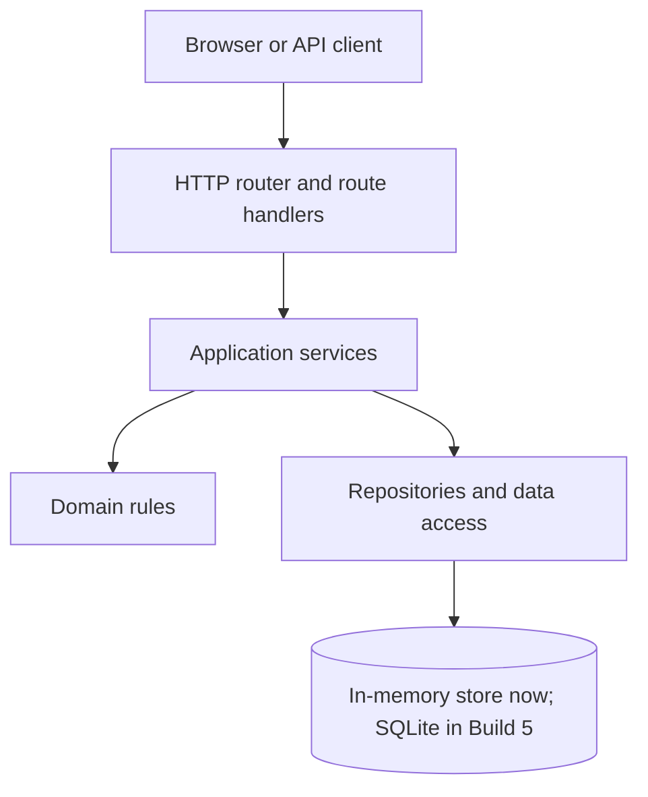
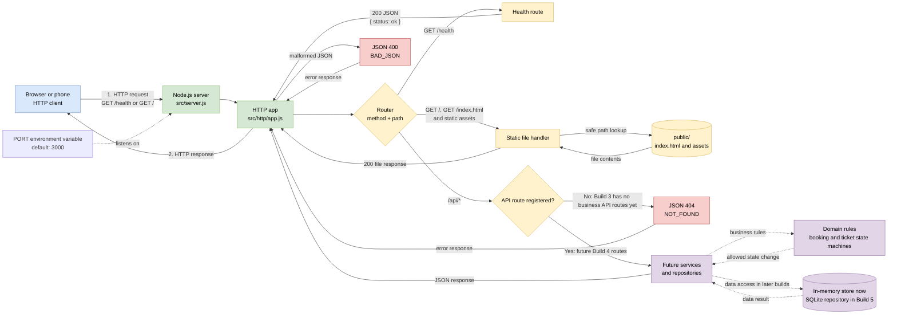
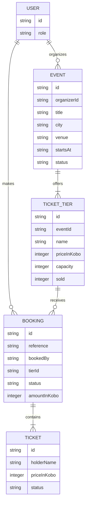
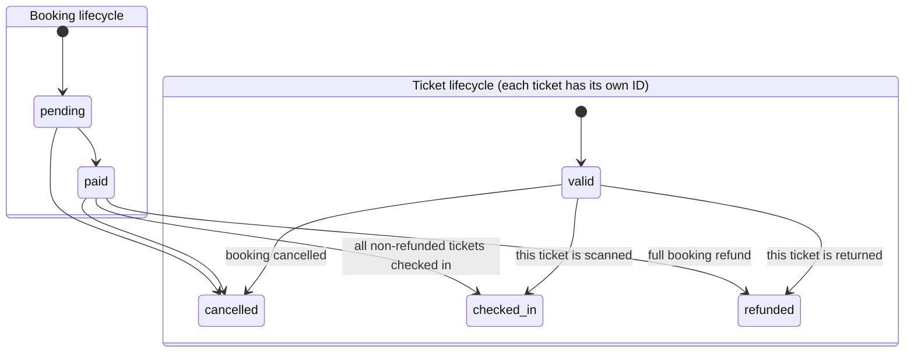

# Build 3 architecture and state diagrams

## Application layers

- **Routes** may read HTTP input, call services, and format HTTP responses; they may not contain booking rules or access storage directly.
- **Services** may coordinate use cases and repositories; they may not decide domain rules themselves or depend on HTTP response objects.
- **Domain rules** may validate and decide business state changes; they may not perform HTTP, file, or database I/O.
- **Repositories** may read and write data; they may not decide business rules or call routes.

Build 3 introduces the router and server skeleton. The service and repository layers are architectural destinations for later builds, not implementations added in this build.

## HTTP request and data flow

Solid arrows show behavior implemented in Build 3. Dashed arrows show connections planned for later builds. The client can be your browser on the same computer during development; this does not require a separate Windows Server machine.

## Data model

Each booking contains separately identified tickets. The current in-memory project stores users as IDs rather than full user records; authentication and user storage arrive in Build 7.

## Booking and ticket life cycles

- Booking moves are `pending -> paid|cancelled` and `paid -> checked_in|refunded|cancelled`. `cancelled`, `refunded`, and `checked_in` are final booking states.
- A ticket moves from `valid` to `refunded`, `cancelled`, or `checked_in`; those ticket states are final.
- Returning one ticket changes only that ticket to `refunded`; the other tickets remain `valid`, and the booking remains `paid` until a full-booking transition occurs.
- A booking is `checked_in` only after every ticket that has not been refunded is checked in. A scan of one ticket is a ticket-level change, not an immediate booking-level change.
- Build 3 documents and validates these moves. Payment, partial refunds, actual ticket scanning, and issuing tickets through an API are later-build behavior.

`GET /health` is the only application route in this skeleton. The server runs locally on the development computer and listens on `PORT` (default `3000`); it does not provision or configure a hosting machine.
