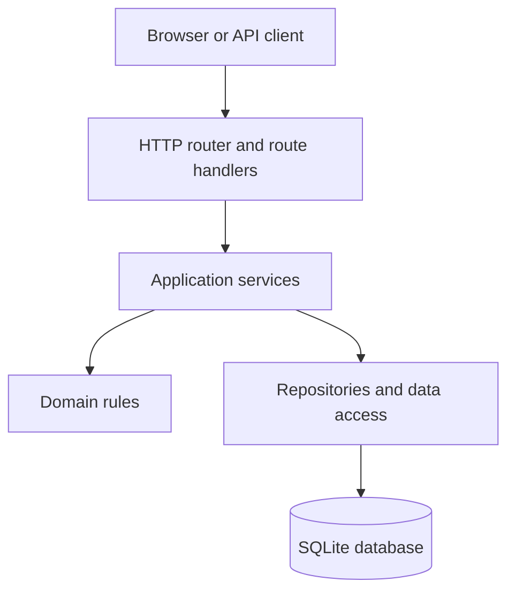
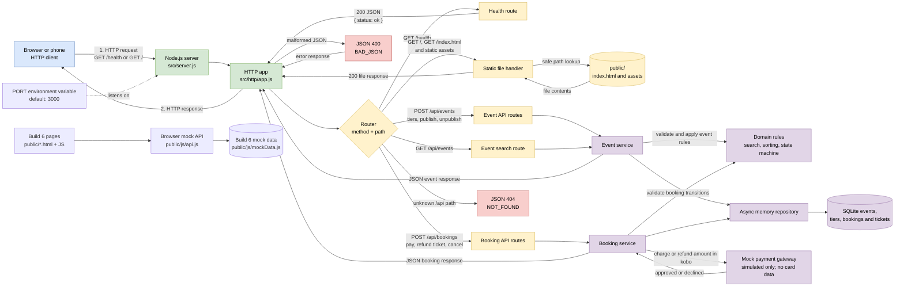
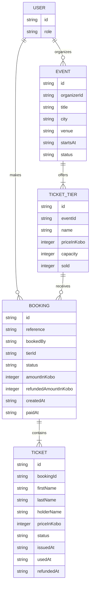
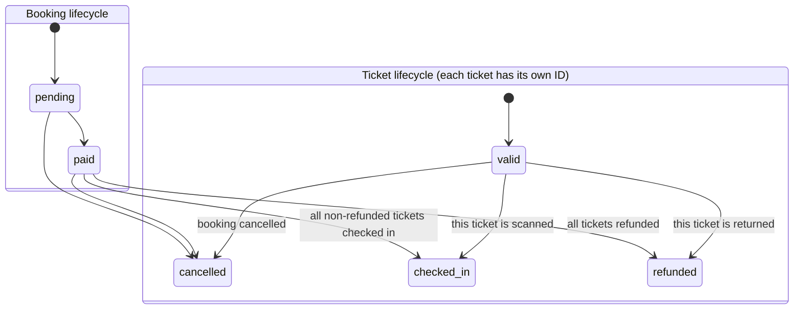

# Build 3-6 architecture and state diagrams

## Application layers

- **Routes** may read HTTP input, call services, and format HTTP responses; they may not contain booking rules or access storage directly.
- **Services** coordinate use cases and repositories, enforce ownership and application rules, and reuse domain rules; they may not depend on HTTP response objects.
- **Domain rules** validate inputs and decide allowed business state changes; they may not perform HTTP, file, or database I/O.
- **Repositories** may read and write data; they may not decide business rules or call routes.

Build 3 introduced the router and server skeleton. Build 4 added services and a memory repository for API tests. Build 5 uses the SQLite repository for the running server so data survives restarts.

Build 6 adds a browser interface that calls one mock API module. Its mock data remains separate from the server database; Build 7 will replace the mock API's internals with real HTTP requests.

## HTTP request and data flow

Build 6 browser pages call only the mock API module, which reads mock data; it does not call the server or SQLite. Builds 3-5 server behavior continues to use SQLite, while API tests may inject an in-memory repository. The client can be your browser on the same computer during development; this does not require a separate Windows Server machine.

## Data model

Each booking contains separately identified tickets. SQLite persists user IDs and ticket records, including individual refund status. Authentication and full user profiles arrive in Build 7.

## Booking and ticket life cycles

- Booking moves are `pending -> paid|cancelled` and `paid -> checked_in|refunded|cancelled`. `cancelled`, `refunded`, and `checked_in` are final booking states.
- A ticket moves from `valid` to `refunded`, `cancelled`, or `checked_in`; those ticket states are final.
- Returning one ticket changes only that ticket to `refunded`; the other tickets remain `valid`, and the booking remains `paid` until a full-booking transition occurs.
- A booking is `checked_in` only after every ticket that has not been refunded is checked in. A scan of one ticket is a ticket-level change, not an immediate booking-level change.
- Builds 3–5 validate these moves. Build 4 pays for the booking total in kobo and supports simulated partial ticket refunds; Build 5 persists these records and reserves capacity with a conditional atomic database update. Actual payment refunds and ticket scanning are later-build behavior.

The server runs locally on the development computer and listens on `PORT` (default `3000`); it does not provision or configure a hosting machine. Build 4 adds the event and booking API routes while continuing to serve `/health` and static files.
